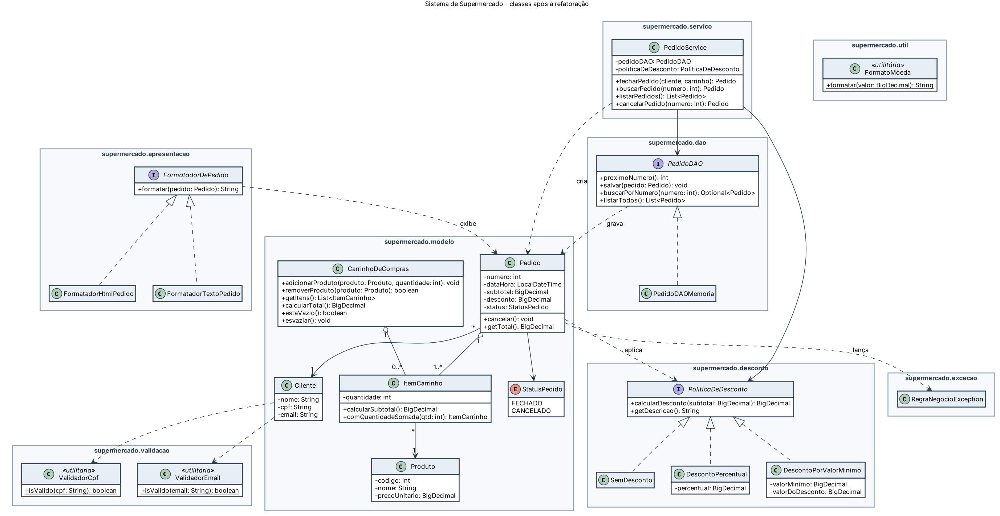

# Supermercado Refatorado

Projeto Integrador (Senac): refatoração do sistema de Supermercado da fase anterior
para separar as **regras de negócio** da **interface**, preparando as classes para
serem reaproveitadas na versão web do sistema.

**Aluno:** Gabriel Ramos Lisboa
**Tecnologias:** Java 11 · NetBeans (projeto Ant) · sem bibliotecas externas

## Como executar

1. No NetBeans: **File > Open Project** e selecione a pasta `SupermercadoRefatorado`.
2. Clique com o botão direito no projeto e escolha **Run** (ou tecle F6).
3. A saída mostra:
   - o pedido da atividade 3 (1 arroz + 2 filé de frango = R$ 47,97) em texto e em HTML;
   - **41 testes** das regras de negócio, com `[OK]` ou `[FALHOU]` em cada um, e o resumo
     `RESULTADO: 41 de 41 testes passaram.`

Se algum teste falhar, o programa termina com código de saída 1.

## Organização em camadas

```
src/supermercado
├── Main.java                 -> ponto de entrada: demonstração + testes no main()
├── modelo/                   -> entidades e regras do domínio
│   ├── Produto, ItemCarrinho, CarrinhoDeCompras
│   ├── Cliente, Pedido, StatusPedido
├── servico/PedidoService     -> casos de uso: fechar, buscar, listar e cancelar pedidos
├── dao/                      -> acesso a dados (PedidoDAO + PedidoDAOMemoria)
├── desconto/                 -> padrão Strategy: SemDesconto, DescontoPercentual, DescontoPorValorMinimo
├── apresentacao/             -> FormatadorDePedido: saída em texto e em HTML
├── validacao/                -> ValidadorCpf, ValidadorEmail
├── excecao/                  -> RegraNegocioException
├── util/                     -> FormatoMoeda (R$ no padrão brasileiro)
└── testes/Verificador        -> apoio aos testes do main()
```

Nenhuma classe de `modelo`, `servico`, `dao`, `desconto` ou `validacao` usa `System.out`
ou classes de tela. Por isso elas podem ser usadas tanto pelo sistema desktop quanto por
Servlets/JSP na versão web.



## Princípios SOLID aplicados (resumo)

| Princípio | Onde |
|---|---|
| **S** - Responsabilidade única | `Pedido` não imprime mais nada; exibição em `FormatadorTextoPedido`/`FormatadorHtmlPedido`; subtotal em `ItemCarrinho`; validações em `ValidadorCpf`/`ValidadorEmail`; persistência em `PedidoDAO`; casos de uso em `PedidoService` |
| **O** - Aberto/fechado | Novas promoções implementam `PoliticaDeDesconto`; novos formatos de saída implementam `FormatadorDePedido`, sem alterar `Pedido` |
| **L** - Substituição de Liskov | Toda `PoliticaDeDesconto` respeita `0 <= desconto <= subtotal` (verificado em teste); `PedidoDAOMemoria` pode ser trocado por um DAO JDBC |
| **I** - Segregação de interfaces | Interfaces pequenas e específicas: `FormatadorDePedido` (1 método), `PoliticaDeDesconto` (2), `PedidoDAO` (4) |
| **D** - Inversão de dependência | `PedidoService` recebe `PedidoDAO` e `PoliticaDeDesconto` (interfaces) pelo construtor |

## Padrões de projeto

- **Strategy** - políticas de desconto intercambiáveis.
- **DAO** - acesso a dados isolado atrás de uma interface.
- **Null Object** - `SemDesconto` evita testes de `null` quando não há promoção.
- **Injeção de dependência pelo construtor** - `Main` monta as dependências.

## Testes unitários (JUnit)

A pasta `SupermercadoTestes` é um projeto NetBeans separado, só com testes **JUnit 4**.
Ele usa o `SupermercadoRefatorado` como dependência (em *Libraries*) e testa as regras de
cálculo e de negócio sem banco de dados:

| Classe de teste | O que verifica |
|---|---|
| `ItemCarrinhoTest` | subtotal (preço x quantidade), precisão com centavos, quantidade inválida |
| `CarrinhoDeComprasTest` | total do carrinho, produto repetido, remoção, lista somente leitura |
| `PedidoTest` | total com e sem desconto, pedido imutável, cancelamento |
| `DescontoPercentualTest` | cálculo e arredondamento do desconto percentual |
| `DescontoPorValorMinimoTest` | valores de fronteira da promoção por valor mínimo |
| `ValidadorCpfTest` | dígitos verificadores do CPF |
| `PedidoServiceTest` | fechar, buscar e cancelar pedidos |

**Como executar:** abra o projeto `SupermercadoTestes` no NetBeans, clique com o botão direito
nele e escolha **Test** (Alt+F6). O resultado aparece na janela *Test Results*: 38 testes.

## Histórico

O primeiro commit contém o código exatamente como foi entregue na atividade 3; cada commit
seguinte aplica uma etapa da refatoração (veja `git log`).
